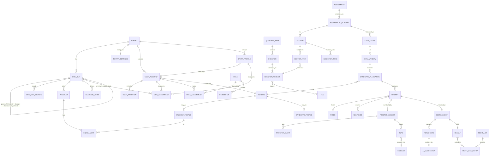

# Ivorovi Domain Model

Status: **Baseline v0.1**. This is the conceptual model. Physical tables are defined per module in Flyway
migrations and must stay consistent with this document. Update both together.

Conventions for every tenant-owned table: `id uuid` (UUIDv7, time-ordered), `tenant_id uuid not null`,
`created_at`, `created_by`, `updated_at`, `updated_by`, `version bigint` (optimistic locking). Soft delete
(`archived_at`) is used only where history matters. Hard delete is reserved for erasure workflows.

## Bounded contexts → modules

| # | Module (package) | Owns aggregates |
|---|---|---|
| 1 | `tenancy` | Tenant, OrgUnit (University/College/Campus/Department), OrgUnitHistory, TenantSettings, Program, AcademicTerm |
| 2 | `identity` | UserAccount, Role, Permission (code catalog), RoleAssignment, UserGroup |
| 3 | `people` | Person, StudentProfile, CandidateProfile, Enrollment, Cohort/Batch |
| 4 | `admissions` | AdmissionCycle, ApplicationForm, Application, EligibilityRuleSet, ScreeningStage |
| 5 | `itembank` | QuestionBank, Question, QuestionVersion, Tag, Taxonomy (subject/topic/Bloom/difficulty), Passage, Media |
| 6 | `authoring` | Assessment, AssessmentVersion, Section, SelectionRule, MarkingScheme, Rubric |
| 7 | `scheduling` | ExamEvent, ExamWindow, Venue, Seat, CandidateAllocation, Accommodation |
| 8 | `delivery` | Attempt, Paper (frozen), Response, AttemptLog |
| 9 | `proctoring` | ProctorSession, ProctorEvent, Snapshot, Flag, Incident, ProctorAssignment |
| 10 | `evaluation` | ScoreSheet, ItemScore, MarkingAllocation, Moderation, ReEvaluationRequest |
| 11 | `academics` | Course, CourseOffering, AssessmentComponent (internal/semester weightage), GradeScale, CourseResult |
| 12 | `coding` | CodingProblem, TestCase, Submission, ExecutionRun (+ code-runner service) |
| 13 | `placement` | Company, RecruiterAccount, Drive, DriveEligibility, DriveRegistration, Shortlist |
| 14 | `results` | Result, ResultPublication, MeritList, MeritListEntry, TieBreakPolicy |
| 15 | `ai` | AiProviderConfig, PromptTemplate, AiJob, AiSuggestion, Recommendation |
| 16 | `analytics` | Read models: ItemStatistics, CohortPerformance, DashboardSnapshot |
| 17 | `notifications` | NotificationTemplate, Notification, Channel prefs; `workflow`: WorkflowDefinition, WorkflowInstance, Task, Approval |
| 18 | `integrations` | ApiClient, Webhook, WebhookDelivery, ImportJob, ExportJob, SisConnector |
| 19 | `audit` | AuditEvent, ConsentRecord, DataRequest (export/erasure), RetentionPolicy |
| 20 | `licensing` | Plan, Subscription, Entitlement, UsageMeter, License (signed, on-prem) |
| 21 | `sysadmin` | FeatureFlag, SystemSetting, MaintenanceWindow, JobRun |

## Core relationships

## Key aggregates and invariants

### Tenancy and identity
* **Tenant**: `code` (unique, slug), `name`, `status (TRIAL|ACTIVE|SUSPENDED|TERMINATED)`, `region`,
  `data_residency`, `branding`. A suspended tenant → all non-admin requests are rejected.
* **OrgUnit** (increment 1.1): `unit_type (UNIVERSITY|COLLEGE|CAMPUS|DEPARTMENT)`, `parent_id`, `code`
  (unique among siblings, case-insensitive), `name`, `short_name`, `status (ACTIVE|INACTIVE)`, `path` (ltree of
  hex ids), `attributes` (city, state, website, email), `branding` (accent colour; universities/colleges only),
  `version`. Allowed parents: COLLEGE → none/UNIVERSITY; CAMPUS → UNIVERSITY/COLLEGE; DEPARTMENT →
  UNIVERSITY/COLLEGE/CAMPUS. Units form the **scope tree** for authorization. Programs (1.3) attach to units.
* **OrgUnitHistory**: append-only before/after snapshots per change (app role may not update/delete).
* **TenantSettings**: per-type display labels and the organization time zone (optimistic `version`).
* **UserAccount**: `external_subject` (IdP `sub`, unique per tenant), `email`, `status`, `person_id?`.
  One human can be a student in one tenant and an evaluator in another as separate accounts.
* **UserAccount (1.2 fields)**: given/family name, phone, normalised email (unique per organization),
  status `INVITED → ACTIVE ⇄ SUSPENDED`, any → `DEACTIVATED` (→ `ACTIVE`, or `INVITED` if never signed in),
  status reason/time/actor, last sign-in; `external_subject` set when the invitation is accepted.
* **UserInvitation**: token SHA-256 hash, `PENDING | ACCEPTED | REVOKED | EXPIRED`, expiry, send count, delivery
  status; at most one open invitation per account.
* **StaffProfile**: staff ID (unique, case-insensitive), names, contact, category (faculty, department/academic
  administrator, evaluator, exam controller, proctor, admissions/placement officer, administrative staff),
  designation, employment status/type, joining date, optional one-to-one link to a user account.
* **OrgAssignment**: user *or* staff profile × unit (null = organization), primary flag, title, optional dates.
  Membership only; permissions come from role assignments.
* **RoleAssignment**: `(user_id, role_id, scope_type, scope_id, valid_from, valid_to)`. Time-bound
  assignments support external evaluators and invigilators.

### People and admissions
* **Person**: shared identity for student, candidate, alumni. PII fields are encrypted where configured.
* **CandidateProfile** becomes a **StudentProfile** on admission conversion (same Person, history kept).
* **AdmissionCycle** → **ScreeningStage[]** (e.g. application review → eligibility → entrance test →
  interview → merit list → offer). Each stage has a type, ordering, and pass rule.
* **EligibilityRuleSet**: declarative rules (JSON, evaluated by a server-side rule engine) on application
  data, e.g. `percentage(12th) >= 60 AND subject_in(PCM)`, with category-wise relaxations. Results are stored
  per application with reasons (explainable).

### Item bank and authoring
* **QuestionVersion**: `type`, `content` (JSONB, type-specific; rich text sanitized server-side),
  `answer_key` (JSONB, encrypted, never serialized to candidate endpoints), `marks`, `negative_marks`,
  `difficulty`, `bloom_level`, `status (DRAFT|IN_REVIEW|APPROVED|RETIRED)`. Immutable after first publish reference.
* **AssessmentVersion**: `purpose`, `duration`, `navigation (FREE|LINEAR|SECTION_LOCKED)`, `shuffle`
  settings, `marking_scheme`, `proctoring_profile`, `status (DRAFT|IN_REVIEW|PUBLISHED|ARCHIVED)`.
  Publishing validates that all selection rules can be satisfied from the pools.

### Delivery
* **Attempt**: `(allocation_id, attempt_no)` unique; `status`, `started_at`, `deadline_at` (server
  computed incl. accommodations), `submitted_at`, `client_info`, `ip`.
* **Paper**: frozen list of question version ids + option permutations + seed. Write-once.
* **Response**: `(attempt_id, question_version_id)` unique; `answer` JSONB, `seq` (monotonic),
  `time_spent_ms`, `flagged_for_review`. Writes after deadline + grace period are rejected.

### Evaluation and results
* **ItemScore**: `auto_score?`, `ai_suggested_score?`, `manual_score?`, `final_score`, `evaluator_id`,
  `source (AUTO|MANUAL|AI_ACCEPTED|AI_EDITED|MODERATED)`. Final score cannot come from AI without a human
  acceptor.
* **Result**: computed from ScoreSheet + policy (normalization/scaling, grace marks, grade scale).
  `status (DRAFT|UNDER_REVIEW|APPROVED|PUBLISHED|WITHHELD|REVISED)`. Published results are versioned. A revision
  creates a new version with a reason, and the original is never edited in place.
* **MeritList**: generated from Results under a `TieBreakPolicy` (e.g. higher section score → earlier DOB →
  application time), with category/quota lists. Approval workflow before publication. Snapshot is immutable.

### Proctoring
* **Flag**: `type`, `confidence`, `source (CLIENT|VISION|PROCTOR)`, `evidence_ref`, `status (OPEN|DISMISSED|CONFIRMED)`.
* **Incident**: groups flags. A decision (`NO_ACTION|WARNING|INVALIDATE_ATTEMPT|REFER_COMMITTEE`) needs a
  human decision-maker with `proctor.decide` permission and a mandatory justification.

### Cross-cutting
* **AuditEvent**: `tenant_id`, `actor_id`, `actor_type`, `action`, `resource_type`, `resource_id`,
  `before`/`after` (JSONB diff, PII-masked), `ip`, `user_agent`, `trace_id`, `prev_hash`, `hash`. Insert-only (enforced by DB grants).
* **OutboxEvent**: `id`, `aggregate_type`, `aggregate_id`, `event_type`, `payload`, `created_at`, `published_at`.
